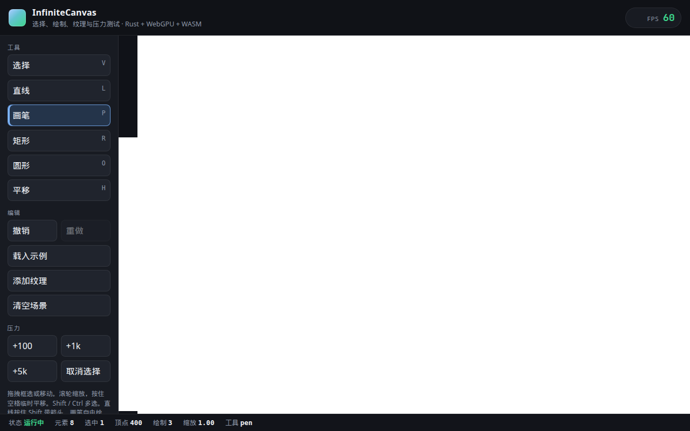
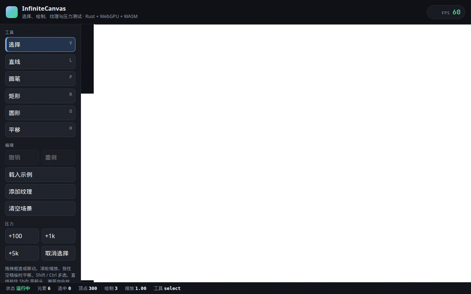
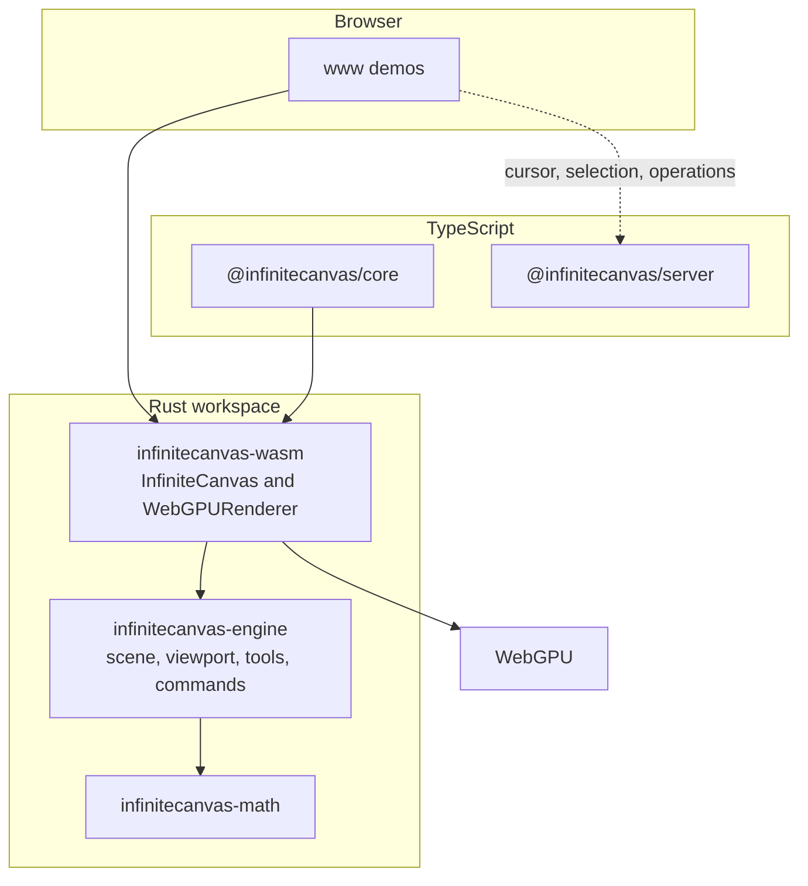

[English](./README.md) | [简体中文](./README.zh-CN.md)

# InfiniteCanvas Engine

Open-source infinite canvas: a Rust core, WebGPU rendering, and a WebAssembly API for the browser.

[](https://github.com/shinjiyu/infinitecanvas_engine/actions/workflows/ci.yml)
[](./LICENSE)
[](./rust-toolchain.toml)
[](./Cargo.toml)
[](./crates/wasm)

**Demo:** [https://shinjiyu.github.io/infinitecanvas_engine/](https://shinjiyu.github.io/infinitecanvas_engine/)

That URL is the GitHub Pages address for `www/index.html`. On 2026-10-14 it returned 404: the [Pages workflow](./.github/workflows/pages.yml) builds `dist/`, then `actions/deploy-pages` fails with “Ensure GitHub Pages has been enabled” until Settings → Pages → Source is GitHub Actions. The frames below are that same page, captured from the local preview in [Quick start](#quick-start).





## Features

Only behavior that exists in this repository is listed here.

### Rendering

- WebGPU renderer on wgpu 27 (`crates/wasm`). Initialization fails if WebGPU is unavailable. There is no Canvas 2D fallback.
- Rectangle, circle, line, freehand path, image, and text elements, with fill, stroke, and a textured pipeline. A line can end in an arrow.
- Image upload from JavaScript (`upload_texture`, `add_image`) and per-image alpha (`set_image_alpha`).
- Text is rasterized with Canvas2D / OffscreenCanvas into a texture (`add_text`, `take_text_raster_jobs`, `commit_text_raster`). Zoom changes pick a new LOD so the glyphs stay sharp. The landing page binds `T` to create text and double-click to edit it.
- Viewport pan and zoom (`pan`, `zoom_at`), clamped to 0.1×–10×, plus screen/world conversion.
- Vertices outside the viewport are skipped while collecting geometry.
- Solid fills go out in one draw and solid strokes in another. Each image texture is its own draw. Selection outlines and the marquee rectangle are drawn after the scene.

### Interaction

- Pointer events drive select, marquee select, drag-move, resize and rotate handles, and drawing, according to the active tool. Drawing tools cover rectangle, circle, line (Shift adds an arrow), pen, text placement, and pan.
- Dragging snaps the selection bounds to other visible elements' edges and centers inside a screen-pixel threshold (`set_snap_enabled`, `set_snap_threshold`, `get_alignment_guides`). The landing page draws those guides. Multi-select snaps the union bounds.
- Hit testing walks the flat scene from the highest z-index and inverse-transforms rotation and scale. It does not consult the QuadTree.
- Command history for add, remove, move, transform, and text content edits, exposed as `undo` and `redo`.
- Tools: Select, Line, Pen, Rectangle, Circle, Text, Pan, and a temporary Hand tool (`push_hand_tool` / `pop_temporary_tool`).
- `www/index.html` binds V / L / P / R / O / H / T, Space, and Ctrl+Z / Ctrl+Y / Ctrl+S / Ctrl+O. Those shortcuts live in the page script. The WASM dispatcher applies pointer events; keyboard and wheel events are queued and otherwise ignored.

### Scene and math

- Flat scene of `Rectangle`, `Circle`, `Image`, `Line`, `Path`, and `Text`. No groups or inherited transforms. Rotation (radians) and scale live on each element's `Transform` (`ElementProps::rotation`).
- `infinitecanvas-math` provides `Vec2`, glam matrices, `Rect`, `Transform`, `Color`, and `Vertex`.
- `QuadTree` supports insert, point query, and range query, and has unit tests. Rendering and hit testing do not call it.

### Persistence

- `Scene::to_json` / `Scene::from_json` write version 1 JSON (`version`, `next_id`, `elements`). Rectangle, circle, image, line (including `arrow`), path, and text round-trip, including `props.transform.rotation` and `scale`. Text stores `content`, `font_size`, `color`, `align`, `font_family`, and `size`. Raster bookkeeping (`texture_id`, LOD, revision, `editing`) is `#[serde(skip)]` and is rebuilt after import.
- Missing optional fields use serde defaults (rotation 0, scale 1, arrow off, visible, opacity 1, color alpha 1, text align left, text size estimated from the content). Unknown fields are ignored, so later optional fields can be added without a version bump. An unknown `version`, malformed JSON, a duplicate id, or an unknown element type such as `group` is an error.
- WASM exposes the same document as `export_json` and `import_json`. Import replaces the scene, rebuilds selection from the `selected` flags, and clears the undo stack.
- `export_png(selectionOnly)` encodes an RGBA PNG of the current viewport, or of the selected elements' bounds when `selectionOnly` is true. Lines, arrows, and paths are rasterized at their stroke width. Text is drawn with the public-domain `font8x8` bitmap (Latin, Greek, hiragana, and the other blocks that crate ships). Characters it does not cover, including CJK, are a box outline — the Canvas2D texture used on screen is not stored in the scene file. Image elements use a flat placeholder for the same reason.
- `export_svg(selectedOnly)` writes an SVG document. The default viewBox is the bounds of every effectively visible leaf; an empty scene uses a 1×1 viewBox. `selectedOnly` keeps leaves whose own `selected` flag is set, and every visible descendant of a selected group. Rect, circle, line/arrow, freehand path, and text keep translation, scale, rotation, fill, stroke, and opacity. Text is a `<text>` element (`font-size`, `font-family`, alignment). Groups are not drawn; children keep the world transforms the scene already stored, and a contiguous group is a `<g id="eN">` without a second transform. A hidden group hides its descendants and leaves them out of the viewBox. Image elements are skipped with a comment in the file (pixels stay on the GPU).
- The landing demo (`www/index.html`) saves and opens that JSON (Ctrl+S / Ctrl+O) and downloads a viewport or selection PNG, plus an SVG of the scene or the selection. It also writes the JSON to `localStorage` under `infinitecanvas.scene.v1`.

### Collaboration

This path is partial.

- `@infinitecanvas/server` is a Node.js WebSocket server with rooms and user sessions.
- The collaboration client in `@infinitecanvas/core` connects, reconnects, and sends cursor, selection, and operation messages.
- `www/test-collab-canvas.html` broadcasts a newly created element and applies a remote add (rectangle or circle) or remove. A remote move is logged and not applied.
- Message types for move and update exist. There is no CRDT, permission check, conflict UI, or history replay.

`@infinitecanvas/core` also has a thin canvas wrapper (`init`, `render`, `startRenderLoop`, `destroy`). The demos talk to the WASM `InfiniteCanvas` directly.

## Architecture



`infinitecanvas-engine::Renderer` does not draw. Drawing is `WebGPURenderer` in the WASM crate. The scene stores elements in a map, not a tree.

## Performance

No benchmark log is checked in. Published numbers are **TBD** until a run is recorded.

| Metric | Result |
| --- | --- |
| Elements sustained at 60 FPS | TBD |
| Frame time | TBD |
| Memory | TBD |
| Release WASM binary (`infinitecanvas_wasm_bg.wasm`) | 2,971,270 bytes |

The binary size is from `wasm-pack build --target web --out-dir ../../packages/core/wasm` on 2026-10-14 (rustc 1.99.0, wasm-pack 0.13.1, wasm-opt). It is the optimized release artifact, not a frame-rate measurement.

`get_performance_stats` exposes a frame counter. Its vertex count is `element_count * 50` and its draw-call count is the constant `3`, so those two fields are estimates, not measurements.

`planning/progress.md` (2025-12-21) notes one manual `www/test-stress.html` session at about 1100 elements and 60 FPS. That note is not a captured log, and it is not a current result. `www/test-performance.html` can create a 10k-element scene; no result from that page is recorded here.

## Roadmap

`planning/progress.md` matches the code. `planning/roadmap.md` is older and still marks M1 as in progress.

| Milestone | In the tree today |
| --- | --- |
| M1 Core rendering | Done: WebGPU rectangles, circles, lines, freehand paths, images, viewport |
| M2 Interaction | Done: hit test, selection, marquee, drag, undo/redo, tools |
| M3 Scene management | Viewport culling, batched solid draws, a persistent vertex cache with per-element dirty flags, performance counters, and a QuadTree module. No scene graph |
| M4 Collaboration | Rooms, cursors, selection sync, and create-element broadcast. No CRDT, permissions, conflict handling, or replay |

## Quick start

Rust stable, [wasm-pack](https://rustwasm.github.io/wasm-pack/installer/), and Node.js 20. `rust-toolchain.toml` selects stable, rustfmt, clippy, and the `wasm32-unknown-unknown` target. These commands are the same ones in [BUILD_GUIDE.md](./BUILD_GUIDE.md) and [CI](./.github/workflows/ci.yml).

```bash
git clone https://github.com/shinjiyu/infinitecanvas_engine.git
cd infinitecanvas_engine

rustup show
rustup target add wasm32-unknown-unknown

# Install wasm-pack once. Either command is enough:
cargo install wasm-pack
# curl https://rustwasm.github.io/wasm-pack/installer/init.sh -sSf | sh

npm ci
cargo test --workspace

cd crates/wasm
wasm-pack build --target web --out-dir ../../packages/core/wasm
cd ../..

npm run dev --workspace=@infinitecanvas/www
```

Open [http://localhost:5179/infinitecanvas_engine/](http://localhost:5179/infinitecanvas_engine/). Vite's `base` is `/infinitecanvas_engine/` and the dev server listens on port 5179.

`./build-wasm.sh` runs that same `wasm-pack` command. When `$HOME/.rustup/toolchains/stable-aarch64-apple-darwin/bin` exists, the script prepends it to `PATH`. Otherwise it uses the `rustc` already on `PATH`.

The root `package.json` scripts still call `pnpm`. CI, this section, and the build guide use `npm ci` and the workspace scripts above. Do not mix in `pnpm install` or `pnpm dev`.

`cargo test --workspace` compiles and tests the host crates, including `infinitecanvas-wasm`. Drawing still happens in a browser with WebGPU (desktop Chrome 113+, Edge 113+, or Safari 18+). Other pages: `www/test-selection.html`, `www/test-stress.html`, `www/test-texture.html`, `www/test-text-raster.html`, and `www/test-collab-canvas.html`.

Collaboration server (optional, port 8080):

```bash
npm run dev --workspace=@infinitecanvas/server
```

## Project layout

```
crates/math/          Vec2, color, rect, transform, vertex
crates/engine/        scene, viewport, hit test, tools, commands, QuadTree
crates/wasm/          WebGPU renderer and the JS API
packages/core/        TypeScript wrapper and collaboration client
packages/server/      WebSocket room server
www/                  Vite demos
```

## Contributing

Bots follow the claim rules in issue [#9](https://github.com/shinjiyu/infinitecanvas_engine/issues/9). Do not claim or close that issue.

- Claim only an issue labeled `status:ready` that has no `claimed:*` label.
- Comment `CLAIM by <name>`, where `<name>` is `a`, `b`, `c`, `d`, or `e`. The first `CLAIM by` comment owns the issue. If that is not you, comment `WITHDRAW by <name>` and pick another issue.
- Then add `claimed:<name>` and `status:in-progress`, and remove `status:ready`. Each name may have only one open claimed issue.
- Branch: `bot-<name>/issue-<number>-<short-description>`. If the issue already has someone else's branch or pull request, stop.
- Pull request title: `[<name>] #<number> <title>`. The description includes `Closes #<number>` and the test results.
- Rebase onto the latest `master` before opening the pull request. Change only files that belong to the issue.
- Comment `PROGRESS by <name>: ...` at least every 24 hours. `RELEASE by <name>` returns the issue to `status:ready`. `BLOCKED by <name>: <reason>` asks for help.

New behavior needs a test first (see `.cursorrules`). Run `cargo test --workspace` before opening a pull request.

## License

The crates declare `MIT OR Apache-2.0`. The file in this repository is the [MIT license](./LICENSE). Copyright Yu Zhenyu ([@shinjiyu](https://github.com/shinjiyu)).

## Further reading

- [Build guide](./BUILD_GUIDE.md)
- [Technical design (Chinese)](./docs/design/技术方案.md)
- [Progress tracker](./planning/progress.md)
