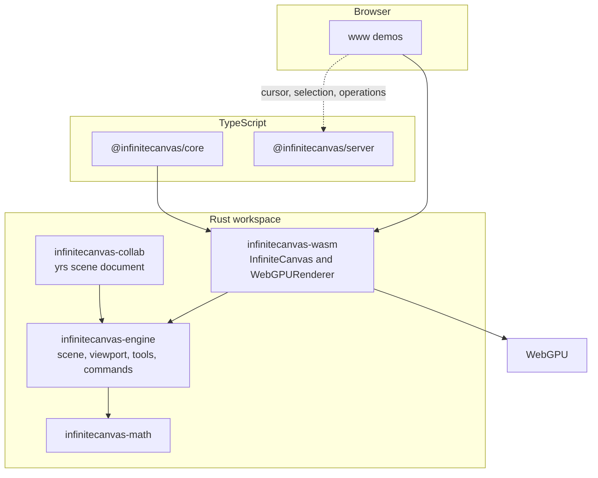

[English](./README.md) | [简体中文](./README.zh-CN.md)

# InfiniteCanvas Engine

Open-source infinite canvas: a Rust core, WebGPU rendering, and a WebAssembly API for the browser.

[](https://github.com/shinjiyu/infinitecanvas_engine/actions/workflows/ci.yml)
[](./LICENSE)
[](./rust-toolchain.toml)
[](./Cargo.toml)
[](./crates/wasm)

**Demo:** [https://shinjiyu.github.io/infinitecanvas_engine/](https://shinjiyu.github.io/infinitecanvas_engine/)

That URL is the GitHub Pages address for `www/index.html`. On 2026-10-14 it returned 404: the [Pages workflow](./.github/workflows/pages.yml) builds `dist/`, then `actions/deploy-pages` fails with “Ensure GitHub Pages has been enabled” until Settings → Pages → Source is GitHub Actions. The frames below are that same page, captured from the local preview in [Quick start](#quick-start).


## Features

Only behavior that exists in this repository is listed here.

### Rendering

- WebGPU renderer on wgpu 27 (`crates/wasm`). Initialization fails if WebGPU is unavailable. There is no Canvas 2D fallback.
- Rectangle, circle, regular polygon, star, line, freehand path, image, and text elements, with fill, stroke, and a textured pipeline. A line can end in an arrow. Polygons default to a hexagon and stars to five points; side count is editable from 3 to 64, and a star also has an inner-radius ratio.
- Image upload from JavaScript (`upload_texture`, `add_image`) and per-image alpha (`set_image_alpha`). `add_image_bytes(bytes, mime, x, y)` decodes a PNG or JPEG, stores the pixels once in a scene asset table, and places a textured element. The landing page accepts drag-and-drop. Ctrl+V pastes an image when the clipboard holds PNG/JPEG bytes, and otherwise pastes element JSON. Edges longer than 4096px are downsampled. Image resize keeps aspect ratio unless Shift is held. The property panel's opacity control writes the same `alpha` and does not touch the asset table.
- Text is rasterized with Canvas2D / OffscreenCanvas into a texture (`add_text`, `take_text_raster_jobs`, `commit_text_raster`). Zoom changes pick a new LOD so the glyphs stay sharp. The landing page binds `T` to create text and double-click to edit it.
- Viewport pan and zoom (`pan`, `zoom_at`, `set_zoom`, `zoom_by`), clamped to 0.1×–10×. Wheel and keyboard share `zoom_step` (`ZOOM_STEP`, 1.1): the wheel pivots on the pointer, keyboard zoom pivots on the camera center. `zoom_to_selection` and `zoom_to_fit` / `fit_scene` use the same limits (10% of the viewport on each side). Screen/world conversion is included.
- Vertices outside the viewport are skipped while collecting geometry.
- Solid fills go out in one draw and solid strokes in another. Each image texture is its own draw. Selection outlines and the marquee rectangle are drawn after the scene.

### Interaction

- Pointer events drive select, marquee select, drag-move, resize and rotate handles, and drawing, according to the active tool. Drawing tools cover rectangle, circle, polygon (`N`), star (`K`), line (Shift adds an arrow), pen, text placement, and pan. Creating a polygon or star, and editing its side count, are undoable.
- Dragging snaps the selection bounds to other visible elements' edges and centers inside a screen-pixel threshold (`set_snap_enabled`, `set_snap_threshold`, `get_alignment_guides`). The landing page draws those guides. Multi-select snaps the union bounds. Manual guides from the rulers use the same threshold (`get_manual_guides`). Resize handles snap the moving element edge to the nearest manual guide. Hiding rulers (`set_rulers_visible`) hides the guides and turns that snap off.
- Hit testing walks the flat scene from the highest z-index and inverse-transforms rotation and scale. It does not consult the QuadTree.
- Command history for add, remove, move, transform, text content edits, and z-order changes, exposed as `undo` and `redo`.
- Tools: Select, Line, Pen, Rectangle, Circle, Polygon, Star, Text, Pan, Eyedropper, and a temporary Hand tool (`push_hand_tool` / `pop_temporary_tool`). Eyedropper samples the topmost visible leaf at a world point (`sample_style_at`) and writes that fill and stroke onto the current selection through `SetStyle` (`apply_sampled_style_at`), one undo step.
- `www/shortcuts.js` is the only shortcut table for the landing page and the `?` help panel (Esc closes the panel; Mac shows ⌘, other platforms show Ctrl). Bindings: V / L / P / R / O / N / K / T / H / I / M / G, Space (temporary pan), Delete / Backspace, Ctrl/Cmd+A, Ctrl/Cmd+C / Ctrl/Cmd+V / Ctrl/Cmd+D (copy, paste, duplicate), arrow keys (nudge 1 world unit, Shift for 10×), `]` / `[` (forward / backward) and Ctrl/Cmd+] / Ctrl/Cmd+[ (front / back), Shift+H / Shift+V (`flip_selection`) and Shift+R / Shift+Alt+R (`rotate_selection_quarter`), Ctrl/Cmd+L (toggle lock) and Ctrl/Cmd+Shift+H (toggle hide), Ctrl/Cmd+G (group) / Ctrl/Cmd+Shift+G (ungroup), Esc, Ctrl/Cmd+Z / Ctrl/Cmd+Y / Ctrl/Cmd+Shift+Z, Ctrl/Cmd+S / Ctrl/Cmd+O, Shift+1 (`zoom_to_fit` / `fit_scene`), Shift+2 (`zoom_to_selection`), Shift+0 and Ctrl/Cmd+0 (100%), and Ctrl/Cmd+= or Ctrl/Cmd++ / Ctrl/Cmd+- (zoom in and out by `zoom_step` around the camera center). The footer shows that scale as a percent after keyboard or wheel zoom. Ctrl/Cmd zoom does not call `preventDefault` while a button or text control is focused, so the browser keeps page zoom there. Plain G shows or hides the rulers and manual guides. Delete or Backspace removes a selected guide before it deletes elements; a double-click on a guide does the same. Plain H / V / R stay tool shortcuts. Plain N and K place a polygon and a star. Plain I is the eyedropper; Shift+I, Ctrl/Cmd+I, and Alt+I do not switch tools. Ctrl or Cmd with these letters does not flip, rotate, or toggle rulers. The layer panel also has 置顶 / 置底 / 前移 / 后移 buttons that call `reorder_selection`. The toolbar and property panel have the same four flip and quarter-turn buttons. The toolbar also has 适应全部 and 缩放到选中, which call the same camera commands. While a text box is focused, Enter commits and Esc cancels that edit. Shortcuts do not run while an input, textarea, select, or contenteditable element is focused. The WASM dispatcher still applies pointer events; keyboard shortcuts are handled in the page. Copy writes the version-1 element JSON (including `assets[]` for selected images) to `navigator.clipboard` and falls back to an in-memory clipboard if that permission fails. Ctrl+V prefers image files on the clipboard; without them it pastes that element JSON.
- The landing page draws a 200×150 minimap in the bottom-right (`M` toggles it). `scene_bounds` unions visible leaves; `minimap_element_rects` maps those boxes into the thumbnail and caches them on `minimap_epoch` (`Scene::geometry_epoch`). Click calls `minimap_to_world` then `set_camera_center`. Dragging the viewport box pans live. Pan and zoom of the main canvas only refresh `minimap_viewport_rect`. A wheel event over the minimap does not zoom the canvas.
- `zoom_to_selection` frames the current selection (visible, unlocked; a group uses the group root's world bounds). `zoom_to_fit` and `fit_scene` frame every visible leaf, the same set as `scene_bounds`. Both leave about 10% of the viewport empty on each side and only move the camera. They are not undoable and do not bump `geometry_epoch`. An empty selection leaves the camera where it is. A scene with no visible leaves resets the camera to the origin at 1×. See [docs/design/camera-fit.md](./docs/design/camera-fit.md).

### Scene and math

- Scene of `Rectangle`, `Circle`, `Polygon` (regular polygon or star), `Image`, `Line`, `Path`, `Text`, and `Group`. Elements live in a map. A group stores child ids; each element stores `parent` and `locked`. A child's `transform` stays in world space, and moving a group writes that delta onto its descendants. Rotation (radians) and scale live on each element's `Transform` (`ElementProps::rotation`).
- `infinitecanvas-math` provides `Vec2`, glam matrices, `Rect`, `Transform`, `Color`, and `Vertex`.
- `QuadTree` supports insert, point query, and range query, and has unit tests. Rendering and hit testing do not call it.

### Persistence

- `Scene::to_json` / `Scene::from_json` write version 1 JSON (`version`, `next_id`, `assets`, `elements`, and `guides` when any exist). Rectangle, circle, polygon (including `kind`, `sides`, and `inner_radius`), image, line (including `arrow`), path, text, and group round-trip, including `props.transform.rotation` and `scale`. `type: "star"` imports as a star. Documents that predate polygons stay valid. Text stores `content`, `font_size`, `color`, `align`, `font_family`, and `size`. A group stores `children`. `parent` and `locked` round-trip (defaults: root and unlocked). Raster bookkeeping (`texture_id`, LOD, revision, `editing`) is `#[serde(skip)]` and is rebuilt after import. Image pixels live in `assets` as one data URL per picture; elements reference `asset_id`. Import decodes the bytes again and reuploads the GPU texture.
- Missing optional fields use serde defaults (rotation 0, scale 1, arrow off, visible, opacity 1, color alpha 1, text align left, text size estimated from the content, `parent` absent, `locked` false). Unknown fields are ignored, so later optional fields can be added without a version bump. An unknown `version`, malformed JSON, a duplicate id, or an unknown element type is an error.
- WASM exposes the same document as `export_json` and `import_json`. Import replaces the scene, rebuilds selection from the `selected` flags, and clears the undo stack.
- `export_png(selectionOnly)` encodes an RGBA PNG of the current viewport, or of the selected elements' bounds when `selectionOnly` is true. Manual guides are not drawn. `export_viewport_png_with_guides(..., true)` is the explicit opt-in. Lines, arrows, and paths are rasterized at their stroke width. Text is drawn with the public-domain `font8x8` bitmap (Latin, Greek, hiragana, and the other blocks that crate ships). Characters it does not cover, including CJK, are a box outline — the Canvas2D texture used on screen is not stored in the scene file. Images that have asset pixels are sampled into the PNG. Images that only name a GPU texture still use a flat placeholder.
- `export_svg(selectedOnly)` writes an SVG document and does not draw manual guides. `export_svg_with_guides(..., true)` adds them inside the existing viewBox. The default viewBox is the bounds of every effectively visible leaf; an empty scene uses a 1×1 viewBox. `selectedOnly` keeps leaves whose own `selected` flag is set, and every visible descendant of a selected group. Rect, circle, polygon, star, line/arrow, freehand path, text, and images with asset pixels keep translation, scale, rotation, and opacity. Polygon and star are an SVG `<polygon>`. Text is a `<text>` element (`font-size`, `font-family`, alignment). An image with pixels is an `<image>` whose `href` is that asset's data URL; a UV crop uses a nested `viewBox`. Images that only name a GPU texture are skipped with a comment. Groups are not drawn; children keep the world transforms the scene already stored, and a contiguous group is a `<g id="eN">` without a second transform. A hidden group hides its descendants and leaves them out of the viewBox.
- `import_svg(svg, x, y)` parses a common SVG subset into scene elements and records one undo step. The anchor is the world position of the viewBox origin (or the user-space origin when there is no viewBox). `rect`, `circle`, `ellipse`, `line`, `polyline`, `polygon`, `path`, and `text` are mapped onto the existing element types. Nested `g` transforms are baked into the children. An SVG `polygon` or `polyline` becomes a freehand path, not the regular polygon or star from the N / K tools. A path or polygon fill is drawn as a stroke, because freehand paths are stroke-only. An `<image>` is imported only when its `href` is a PNG or JPEG data URL. Empty text, invalid XML, and a document with no supported shapes return an error and leave the scene unchanged. Filters, animation, CSS classes, `<use>`, gradients, clipping, and `preserveAspectRatio` are ignored.
- The landing demo (`www/index.html`) saves and opens that JSON (Ctrl+S / Ctrl+O), downloads a viewport or selection PNG, and downloads an SVG of the scene or the selection. It also writes the JSON to `localStorage` under `infinitecanvas.scene.v1`. Drag-and-drop places PNG/JPEG images. Dropping a `.svg` file, or using Import SVG, parses that file at the pointer (or at world `(24, 24)` if the pointer has not entered the canvas). Ctrl+V does the same when the clipboard contains image files, and otherwise pastes copied elements. An SVG file on the clipboard is imported instead of being sent through the image decoder.

### Collaboration

Two paths. They do not talk to each other.

Presence is partial:

- `@infinitecanvas/server` is a Node.js WebSocket server with rooms and user sessions.
- The collaboration client in `@infinitecanvas/core` connects, reconnects, and sends cursor, selection, and operation messages.
- `www/test-collab-canvas.html` broadcasts a newly created element and applies a remote add (rectangle or circle) or remove. A remote move is logged and not applied.
- Message types for move and update exist. There is no permission check, conflict UI, or history replay.

Scene CRDT is a host-side skeleton in `infinitecanvas-collab` ([yrs](https://docs.rs/yrs), the Rust port of Yjs). It is not linked into the WASM crate, and the browser demo does not load it. Edits go through `CollabSession::insert`, `update`, and `delete`. Grouping goes through `group`, `ungroup`, `set_locked`, and `set_world_transform`, which write the group's `children`, each element's `parent` and `locked`, and descendant world transforms into the same document. Two sessions catch up with `MemoryProvider::sync` (in-memory y-sync, no room server). `encode_state_v1` / `apply_update` are Yjs v1 bytes, so a later JavaScript provider can carry the same payload. Give each peer its own `client_id` and `peer_slot`. `peer_slot` must fit in 21 bits (`<= 2_097_151`); `allocate_id` is `(slot << 32) | seq` and stays within the JavaScript safe integer `2^53 - 1`. The group id uses that allocator, not `Scene::next_id`. Text round-trips with the scene JSON (`content`, `font_size`, `color`, and the other layout fields). Raster bookkeeping such as `texture_id` is not stored, so the remote peer materializes it empty. Conflict rules and limits: [docs/design/crdt.md](./docs/design/crdt.md).

```bash
cargo test -p infinitecanvas-collab
```

```rust
use infinitecanvas_collab::{CollabSession, MemoryProvider};
use infinitecanvas_engine::math::Vec2;
use infinitecanvas_engine::{AnyElement, Rectangle};

fn enable() -> Result<(), infinitecanvas_collab::CollabError> {
    let mut local = CollabSession::with_client_id(1, 1);
    let mut remote = CollabSession::with_client_id(2, 2);
    let id = local.allocate_id();
    local.insert(AnyElement::Rectangle(Rectangle::new(
        id,
        Vec2::new(1.0, 2.0),
        Vec2::new(3.0, 4.0),
    )))?;
    MemoryProvider::sync(&mut local, &mut remote)?;
    assert_eq!(local.scene(), remote.scene());
    Ok(())
}
```

`@infinitecanvas/core` also has a thin canvas wrapper (`init`, `render`, `startRenderLoop`, `destroy`). The demos talk to the WASM `InfiniteCanvas` directly.

## Architecture



`infinitecanvas-engine::Renderer` does not draw. Drawing is `WebGPURenderer` in the WASM crate. The scene stores elements in a map, not a tree.

## Performance

Measured on **2026-10-14** at `73f087a` (`73f087a1435645feeeaf1278a3f2a016873ecfcb`), rebased onto `49c47af`. This harness does not change the renderer. Raw log: [docs/perf/2026-10-14.md](./docs/perf/2026-10-14.md) and [docs/perf/2026-10-14.json](./docs/perf/2026-10-14.json).

Environment: Linux 6.12.94+ x64, 4 logical CPUs (Intel Xeon), 16 GB RAM, no `/dev/dri`. Headless Chrome 154.0.8037.92. WebGPU adapter: SwiftShader Device (Subzero), not a fallback adapter. Canvas 1280×720. rustc 1.99.0, wasm-pack 0.13.1 with wasm-opt. Release `infinitecanvas_wasm_bg.wasm` is **3,177,340 bytes**.

The scene is `load_stress_scene`: filled rectangles, 400 columns, 24 px spacing, 16×12. Steady samples are 119 frame intervals (120 `render()` calls after 30 warmup frames). The first interval is dropped. About 60 FPS means average FPS ≥ 55 and P95 frame interval ≤ 20 ms. Dirty flags stayed on: after the steady sample and after `pan(24, 16)`, `geometryUnchanged` was true and regenerated elements were 0. The draw path submits the whole vertex cache (one draw of `count * 6` vertices). Culling was not turned off.

Frame interval is the animation-frame period, so a 60 Hz headless Chrome sits near 16.7 ms even when `render()` returns sooner. Submit time is `performance.now()` around `render()` only. That call returns after `queue.submit` and `present`. It does **not** include a GPU timestamp. On this SwiftShader host, `present` did not add raster time, so submit time stays about 0.12–0.14 ms from 1k through 100k. Cold frame time is the first `render()` after the scene load (vertex-cache build plus full upload) and does grow with the scene.

| Elements | Avg frame | P95 frame | Avg FPS | ~60 FPS | Avg submit | P95 submit | Cold frame | WASM heap | JS heap used |
| --- | ---: | ---: | ---: | --- | ---: | ---: | ---: | ---: | ---: |
| 1,000 | 16.67 ms | 17.00 ms | 60.0 | yes | 0.12 ms | 0.20 ms | 7.60 ms | 2,686,976 | 1,715,643 |
| 10,000 | 16.66 ms | 17.00 ms | 60.0 | yes | 0.14 ms | 0.20 ms | 15.60 ms | 11,796,480 | 1,743,244 |
| 100,000 | 16.67 ms | 17.10 ms | 60.0 | yes | 0.13 ms | 0.20 ms | 101.10 ms | 89,980,928 | 20,954,327 |

100k ran on this machine (load 30.1 ms, cold upload 19,200,000 bytes, 600,000 vertices, 1 draw call). Heap figures are `WebAssembly.Memory.buffer.byteLength` and Chromium `performance.memory.usedJSHeapSize` after that scene was resident. Cold frame time is a single sample; earlier runs on the same host put the 100k cold frame between about 76 ms and 99 ms, and this run was 101.10 ms. Steady frame interval and submit time stayed on the figures above.

Reproduce (Chrome required; the script adds headless WebGPU / SwiftShader flags):

```bash
cd crates/wasm
wasm-pack build --target web --out-dir ../../packages/core/wasm
cd ../..

npm run bench:smoke          # 1k only, exits 0 even if 60 FPS is missed
npm run bench                # 1k, 10k, and 100k
node scripts/bench.mjs --out docs/perf/run.json --markdown docs/perf/run.md
```

CI runs `node --test scripts/bench-stats.test.mjs scripts/cdp.test.mjs` and `npm run bench:smoke` after the wasm build. The smoke path does not gate on 60 FPS. `www/test-stress.html` and `www/bench.html` are the same scene for a manual session.

The bench script drives Chrome through the DevTools protocol. Node 22+ uses the built-in `WebSocket`. Node 20, which CI and the quick start install, has no global `WebSocket`, so `scripts/cdp.mjs` uses the `undici` client (`addEventListener` / `send` / `close`).

## Roadmap

`planning/progress.md` matches the code. `planning/roadmap.md` is older and still marks M1 as in progress.

| Milestone | In the tree today |
| --- | --- |
| M1 Core rendering | Done: WebGPU rectangles, circles, lines, freehand paths, images, viewport |
| M2 Interaction | Done: hit test, selection, marquee, drag, undo/redo, tools |
| M3 Scene management | Viewport culling, batched solid draws, a persistent vertex cache with per-element dirty flags, performance counters, and a QuadTree module. No scene graph |
| M4 Collaboration | Rooms, cursors, selection sync, create-element broadcast, and a yrs CRDT skeleton (`infinitecanvas-collab`) for scene elements. The CRDT is not wired to the WebSocket server, WASM, or the browser demo. No permissions, conflict UI, or history replay |

## Quick start

Rust stable, [wasm-pack](https://rustwasm.github.io/wasm-pack/installer/), and Node.js 20. `rust-toolchain.toml` selects stable, rustfmt, clippy, and the `wasm32-unknown-unknown` target. These commands are the same ones in [BUILD_GUIDE.md](./BUILD_GUIDE.md) and [CI](./.github/workflows/ci.yml).

```bash
git clone https://github.com/shinjiyu/infinitecanvas_engine.git
cd infinitecanvas_engine

rustup show
rustup target add wasm32-unknown-unknown

# Install wasm-pack once. Either command is enough:
cargo install wasm-pack
# curl https://rustwasm.github.io/wasm-pack/installer/init.sh -sSf | sh

npm ci
cargo test --workspace

cd crates/wasm
wasm-pack build --target web --out-dir ../../packages/core/wasm
cd ../..

npm run dev --workspace=@infinitecanvas/www
```

Open [http://localhost:5179/infinitecanvas_engine/](http://localhost:5179/infinitecanvas_engine/). Vite's `base` is `/infinitecanvas_engine/` and the dev server listens on port 5179.

`./build-wasm.sh` runs that same `wasm-pack` command. When `$HOME/.rustup/toolchains/stable-aarch64-apple-darwin/bin` exists, the script prepends it to `PATH`. Otherwise it uses the `rustc` already on `PATH`.

The root `package.json` scripts still call `pnpm`. CI, this section, and the build guide use `npm ci` and the workspace scripts above. Do not mix in `pnpm install` or `pnpm dev`.

`cargo test --workspace` compiles and tests the host crates, including `infinitecanvas-wasm`. Drawing still happens in a browser with WebGPU (desktop Chrome 113+, Edge 113+, or Safari 18+). Other pages: `www/test-selection.html`, `www/test-stress.html`, `www/test-texture.html`, `www/test-text-raster.html`, and `www/test-collab-canvas.html`.

Collaboration server (optional, port 8080):

```bash
npm run dev --workspace=@infinitecanvas/server
```

## Project layout

```
crates/math/          Vec2, color, rect, transform, vertex
crates/engine/        scene, viewport, hit test, tools, commands, QuadTree
crates/collab/        Yjs/yrs scene document (not linked into WASM)
crates/wasm/          WebGPU renderer and the JS API
packages/core/        TypeScript wrapper and collaboration client
packages/server/      WebSocket room server
www/                  Vite demos
```

## Contributing

Bots follow the claim rules in issue [#9](https://github.com/shinjiyu/infinitecanvas_engine/issues/9). Do not claim or close that issue.

- Claim only an issue labeled `status:ready` that has no `claimed:*` label.
- Comment `CLAIM by <name>`, where `<name>` is `a`, `b`, `c`, `d`, or `e`. The first `CLAIM by` comment owns the issue. If that is not you, comment `WITHDRAW by <name>` and pick another issue.
- Then add `claimed:<name>` and `status:in-progress`, and remove `status:ready`. Each name may have only one open claimed issue.
- Branch: `bot-<name>/issue-<number>-<short-description>`. If the issue already has someone else's branch or pull request, stop.
- Pull request title: `[<name>] #<number> <title>`. The description includes `Closes #<number>` and the test results.
- Rebase onto the latest `master` before opening the pull request. Change only files that belong to the issue.
- Comment `PROGRESS by <name>: ...` at least every 24 hours. `RELEASE by <name>` returns the issue to `status:ready`. `BLOCKED by <name>: <reason>` asks for help.

New behavior needs a test first (see `.cursorrules`). Run `cargo test --workspace` before opening a pull request.

## License

The crates declare `MIT OR Apache-2.0`. The file in this repository is the [MIT license](./LICENSE). Copyright Yu Zhenyu ([@shinjiyu](https://github.com/shinjiyu)).

## Further reading

- [Build guide](./BUILD_GUIDE.md)
- [Technical design (Chinese)](./docs/design/技术方案.md)
- [Progress tracker](./planning/progress.md)
