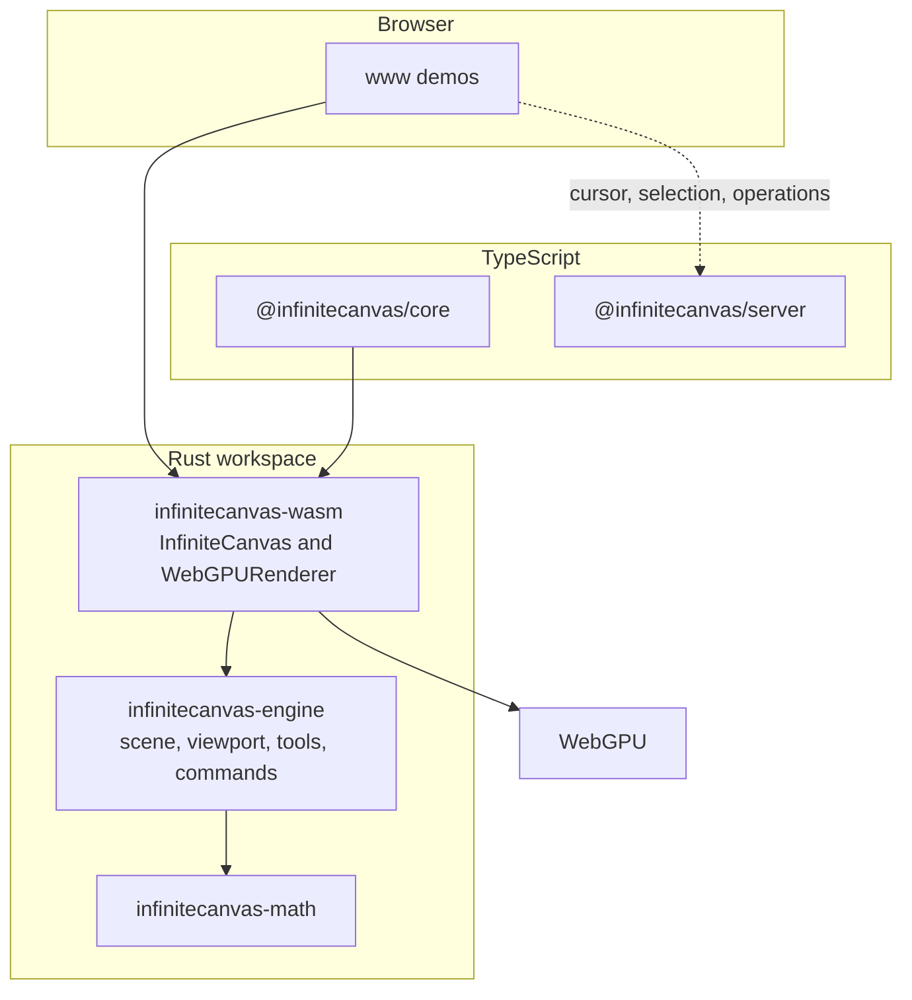

[English](./README.md) | [简体中文](./README.zh-CN.md)

# InfiniteCanvas Engine

Open-source infinite canvas: a Rust core, WebGPU rendering, and a WebAssembly API for the browser.

[](https://github.com/shinjiyu/infinitecanvas_engine/actions/workflows/ci.yml)
[](./LICENSE)
[](./rust-toolchain.toml)
[](./Cargo.toml)
[](./crates/wasm)

**Demo:** [shinjiyu.github.io/infinitecanvas_engine](https://shinjiyu.github.io/infinitecanvas_engine/) — GitHub Pages is not live yet.

<!-- GIF placeholder. Replace this image after GitHub Pages is published. -->


## Features

Only behavior that exists in this repository is listed here.

### Rendering

- WebGPU renderer on wgpu 27 (`crates/wasm`). Initialization fails if WebGPU is unavailable. There is no Canvas 2D fallback.
- Rectangle, circle, and image elements, with fill, stroke, and a textured pipeline.
- Image upload from JavaScript (`upload_texture`, `add_image`) and per-image alpha (`set_image_alpha`).
- Viewport pan and zoom (`pan`, `zoom_at`), clamped to 0.1×–10×, plus screen/world conversion.
- Vertices outside the viewport are skipped while collecting geometry.
- Solid fills go out in one draw and solid strokes in another. Each image texture is its own draw. Selection outlines and the marquee rectangle are drawn after the scene.

### Interaction

- Pointer events drive select, marquee select, drag-move, rectangle and circle drawing, and pan, according to the active tool.
- Hit testing walks the flat scene from the highest z-index. It does not consult the QuadTree.
- Command history for add, remove, and move, exposed as `undo` and `redo`.
- Tools: Select, Rectangle, Circle, Pan, and a temporary Hand tool (`push_hand_tool` / `pop_temporary_tool`).
- The pages under `www/` bind V / R / O / H, Space, and Ctrl+Z / Ctrl+Y. Those shortcuts live in the page scripts. The WASM dispatcher applies pointer events; keyboard and wheel events are queued and otherwise ignored.

### Scene and math

- Flat scene of `Rectangle`, `Circle`, and `Image`. No groups, inherited transforms, text, or paths.
- `infinitecanvas-math` provides `Vec2`, glam matrices, `Rect`, `Transform`, `Color`, and `Vertex`.
- `QuadTree` supports insert, point query, and range query, and has unit tests. Rendering and hit testing do not call it.

### Collaboration

This path is partial.

- `@infinitecanvas/server` is a Node.js WebSocket server with rooms and user sessions.
- The collaboration client in `@infinitecanvas/core` connects, reconnects, and sends cursor, selection, and operation messages.
- `www/test-collab-canvas.html` broadcasts a newly created element and applies a remote add (rectangle or circle) or remove. A remote move is logged and not applied.
- Message types for move and update exist. There is no CRDT, permission check, conflict UI, or history replay.

`@infinitecanvas/core` also has a thin canvas wrapper (`init`, `render`, `startRenderLoop`, `destroy`). The demos talk to the WASM `InfiniteCanvas` directly.

## Architecture



`infinitecanvas-engine::Renderer` does not draw. Drawing is `WebGPURenderer` in the WASM crate. The scene stores elements in a map, not a tree.

## Performance

No benchmark log is checked in. Published numbers are **TBD** until a run is recorded.

| Metric | Result |
| --- | --- |
| Elements sustained at 60 FPS | TBD |
| Frame time | TBD |
| Memory | TBD |
| Release WASM binary (`infinitecanvas_wasm_bg.wasm`) | 2,617,632 bytes |

The binary size is from `./build-wasm.sh` on 2026-10-13 (rustc 1.99.0, wasm-pack 0.13.1, wasm-opt). It is the optimized release artifact, not a frame-rate measurement.

`get_performance_stats` exposes a frame counter. Its vertex count is `element_count * 50` and its draw-call count is the constant `3`, so those two fields are estimates, not measurements.

`planning/progress.md` (2025-12-21) notes one manual `www/test-stress.html` session at about 1100 elements and 60 FPS. That note is not a captured log, and it is not a current result. `www/test-performance.html` can create a 10k-element scene; no result from that page is recorded here.

## Roadmap

`planning/progress.md` matches the code. `planning/roadmap.md` is older and still marks M1 as in progress.

| Milestone | In the tree today |
| --- | --- |
| M1 Core rendering | Done: WebGPU rectangles, circles, images, viewport |
| M2 Interaction | Done: hit test, selection, marquee, drag, undo/redo, tools |
| M3 Scene management | Viewport culling, batched solid draws, performance counters, and a QuadTree module. No scene graph, dirty rectangles, or vertex cache |
| M4 Collaboration | Rooms, cursors, selection sync, and create-element broadcast. No CRDT, permissions, conflict handling, or replay |

## Quick start

You need Rust stable (`rust-toolchain.toml` already asks for `wasm32-unknown-unknown`), [wasm-pack](https://rustwasm.github.io/wasm-pack/installer/), and Node.js for the demo and the collaboration server.

```bash
git clone https://github.com/shinjiyu/infinitecanvas_engine.git
cd infinitecanvas_engine

cargo test -p infinitecanvas-math

./build-wasm.sh
```

`./build-wasm.sh` runs `wasm-pack build --target web --out-dir ../../packages/core/wasm` from `crates/wasm`. It also prepends a macOS rustup directory to `PATH`. On other systems the system `rustc` is still used if that directory is absent. The equivalent command is:

```bash
cd crates/wasm
wasm-pack build --target web --out-dir ../../packages/core/wasm
```

`cargo build` and `cargo test --workspace` do not succeed on a host target today:

- `infinitecanvas-wasm` calls `wgpu::SurfaceTarget::Canvas`, which exists for `wasm32` and not for the host, so the native library does not compile.
- `infinitecanvas-engine` library tests do not compile: the `Image` tests call `id`, `is_visible`, `set_visible`, `z_index`, and `set_z_index`, and those methods are not available on `Image`.

`cargo test -p infinitecanvas-math` does pass. `./build-wasm.sh` is the build that matches how the demos load the engine.

Web demo:

```bash
cd www
npm install
npm run dev
```

Collaboration server (optional, port 8080):

```bash
cd packages/server
npm install
npm run dev
```

The demo pages need a browser with WebGPU. Useful entry points: `www/test-selection.html`, `www/test-stress.html`, `www/test-texture.html`, and `www/test-collab-canvas.html`.

## Project layout

```
crates/math/          Vec2, color, rect, transform, vertex
crates/engine/        scene, viewport, hit test, tools, commands, QuadTree
crates/wasm/          WebGPU renderer and the JS API
packages/core/        TypeScript wrapper and collaboration client
packages/server/      WebSocket room server
www/                  Vite demos
```

## Contributing

Bots follow the claim rules in issue [#9](https://github.com/shinjiyu/infinitecanvas_engine/issues/9). Do not claim or close that issue.

- Claim only an issue labeled `status:ready` that has no `claimed:*` label.
- Comment `CLAIM by <name>`, where `<name>` is `a`, `b`, `c`, `d`, or `e`. The first `CLAIM by` comment owns the issue. If that is not you, comment `WITHDRAW by <name>` and pick another issue.
- Then add `claimed:<name>` and `status:in-progress`, and remove `status:ready`. Each name may have only one open claimed issue.
- Branch: `bot-<name>/issue-<number>-<short-description>`. If the issue already has someone else's branch or pull request, stop.
- Pull request title: `[<name>] #<number> <title>`. The description includes `Closes #<number>` and the test results.
- Rebase onto the latest `master` before opening the pull request. Change only files that belong to the issue.
- Comment `PROGRESS by <name>: ...` at least every 24 hours. `RELEASE by <name>` returns the issue to `status:ready`. `BLOCKED by <name>: <reason>` asks for help.

New behavior needs a test first (see `.cursorrules`). `cargo test --workspace` is currently red; the Quick start section lists why.

## License

The crates declare `MIT OR Apache-2.0`. The file in this repository is the [MIT license](./LICENSE). Copyright Yu Zhenyu ([@shinjiyu](https://github.com/shinjiyu)).

## Further reading

- [Build guide](./BUILD_GUIDE.md)
- [Technical design (Chinese)](./docs/design/技术方案.md)
- [Progress tracker](./planning/progress.md)
